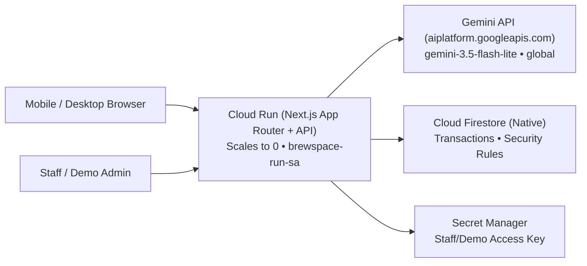

# BrewSpace AI

**Your café. Your space. Your people.**

BrewSpace AI is a mobile-first, intent-aware café companion built with **Next.js (TypeScript)**, **Google Gemini (`@google/genai`)**, **Cloud Firestore**, and **Google Cloud Run**. By scanning a café QR code, visitors describe what they want from their visit in natural language—quiet focus, an outlet-equipped desk, a 1:1 conversation afterward, or a 20-minute small-group discussion—and BrewSpace coordinates three modules through one shared, real-time **Visit Context**.

---

## Core Modules

- **Café Flow (`My Space`)** — Rule-based seat recommendations (`Quiet`, `General`, `Social`, `Group`), atomic seat claiming that prevents double-booking under concurrency, and a distraction-free Focus Timer.
- **Café Connect (`Connect`)** — Respectful, opt-in 1:1 introductions. Discovery is **off by default**, paused automatically during focus sessions, and strictly anonymized (no alias or exact seat disclosed) until **both** visitors accept.
- **Coffee Circles (`Circles`)** — Timed 20-minute small-group discussions (3–6 guests). Separates RSVP status from group confirmation: a circle activates only after reaching quorum (≥ 3) and atomically holding an available group table—with automatic table relocation or clean cancellation if floor occupancy changes.
- **Ask BrewSpace (`Assistant`)** — Contextual Gemini-powered assistant (`gemini-3.5-flash-lite`) grounded in authoritative server state, with graceful manual fallback when AI is unavailable.
- **Staff Operations Console & Demo Simulator (`/staff`, `/demo`)** — Strictly role-gated operational floor map, live circle monitor, and hackathon scenario simulator (isolated from customer navigation and never exposing private visitor interests).

---

## Architecture



### Design & Engineering Principles
- **AI for understanding; code for enforcement:** Gemini extracts structured intent (validated via strict Zod schemas) and generates conversation prompts, while deterministic backend services enforce seat availability, consent gates, mutual acceptance, quorum, and conflict resolution.
- **Privacy & calm by default:** Scanning a QR code creates zero social exposure. Connect and Circles are independent off-by-default toggles, and focus sessions suppress proactive social prompts.
- **Serverless, cost-efficient architecture:** Single Cloud Run container (`--min-instances=0`, `--max-instances=2`, 512Mi), Firestore Native free-tier friendly design, Artifact Registry image cleanup policy (keeps 3 recent images), `gemini-3.5-flash-lite` on `global`, and configurable Cloud Billing Budget alerts at 50%, 90%, and 100%.

---

## Tech Stack

- **Frontend:** Next.js 14 (App Router), React 18, TypeScript, Tailwind CSS (*Cozy Futurism* design system — `Fraunces` + `DM Sans`)
- **Backend:** Next.js Route Handlers, Zod strict schema validation, Firebase Admin SDK
- **AI:** Unified Google Gen AI SDK (`@google/genai`) targeting `gemini-3.5-flash-lite` on Gemini platform (`global`)
- **Data & Security:** Cloud Firestore (`firestore.rules`, `firestore.indexes.json`), Secret Manager, dedicated least-privilege IAM service accounts
- **CI/CD & Infra:** Idempotent `infra/setup.sh`, `Dockerfile` (`node:22-alpine`, standalone output), `cloudbuild.yaml`

---

## Run Locally (Zero GCP Setup Required)

> Requires **Node.js >= 18.17** (Node 20 LTS or 22 LTS recommended).

```bash
# 1. Copy local environment template (uses seeded in-memory store by default)
cp .env.example .env.local

# 2. Install dependencies
npm install

# 3. Run typecheck and unit/integration tests (11 tests across 3 suites)
npm run typecheck
npm test

# 4. Start the development server
npm run dev
```

*(On Windows PowerShell, if `npm.ps1` is blocked by execution policy, run `npm.cmd run dev`.)*

Open **`http://localhost:3000`** to start the guest journey at **Roastery & Co.** (`/c/roastery-co`):
1. Enter a display alias and describe a visit (e.g., *"I want a quiet table with an outlet for 60 minutes, then meet people interested in AI startups"*).
2. Review/edit the parsed plan, toggle Connect/Circles consents, confirm quiet seat **Q3**, finish focus, and join **AI Builders & Startup Ideas** to reach quorum and hold Group Table **G1**.
3. Open **`http://localhost:3000/staff/login`**, select **Demo Administrator**, and sign in with `local-dev-only-change-me` to test the **Staff Operations Console** (`/staff/roastery-co`) and **Demo Simulator** (`/demo/roastery-co`), including live group-table conflict relocation (`G1` → `G2`).

---

## Deploy to Google Cloud Run

Full step-by-step instructions are in [DEPLOYMENT.md](./DEPLOYMENT.md). Quick summary from **Google Cloud Shell**:

```bash
export PROJECT_ID="<YOUR_PROJECT_ID>"
export REGION="asia-south1"

# 1. Authenticate Firebase CLI
npx -y firebase-tools@latest login --no-localhost

# 2. Bootstrap APIs, least-privilege SAs, Firestore, Artifact Registry, Secret Manager & budget alerts
PROJECT_ID="$PROJECT_ID" REGION="$REGION" bash infra/setup.sh

# 3. Build & deploy via Cloud Build -> Artifact Registry -> Cloud Run
gcloud builds submit \
  --project="$PROJECT_ID" \
  --config=cloudbuild.yaml \
  --service-account="projects/${PROJECT_ID}/serviceAccounts/brewspace-build-sa@${PROJECT_ID}.iam.gserviceaccount.com" \
  --substitutions="_REGION=${REGION},_REPO=brewspace-repo,_SERVICE=brewspace-web,SHORT_SHA=v1"
```

---

## Project Structure

```text
├── infra/setup.sh              # Idempotent gcloud & Firebase bootstrap script
├── cloudbuild.yaml             # Cloud Build -> Artifact Registry -> Cloud Run pipeline
├── Dockerfile                  # Production standalone Next.js container (0.0.0.0:$PORT)
├── firestore.rules             # Privacy-enforcing Firestore security rules
├── firestore.indexes.json      # Composite Firestore indexes
├── scripts/seed-staff-claims.mjs
├── src/
│   ├── app/
│   │   ├── c/[cafeId]/         # QR welcome (E01) & guest identity (E02)
│   │   ├── visit/              # Onboarding (E03–E06), Today, Space, Connect, Circles, Settings
│   │   ├── staff/              # Role-gated Staff Operations Console (O00–O03)
│   │   ├── demo/               # Restricted Hackathon Demo Simulator (D01)
│   │   └── api/                # Authoritative REST Route Handlers
│   ├── components/VisitShell.tsx
│   └── lib/
│       ├── services/           # Deterministic Flow, Connect, Circles & Visit Lifecycle engines
│       ├── gemini.ts           # @google/genai structured intent parser + fallback
│       ├── store.ts            # Dual-mode Cloud Firestore / in-memory repository
│       └── __tests__/          # Unit & concurrency/orchestration tests
└── DEPLOYMENT.md               # Complete Cloud Run & operations runbook
```

---

## License

Apache 2.0
